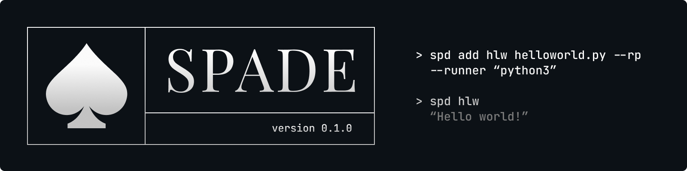

# 

Spade is a lightweight CLI to save, manage, and run reusable command shortcuts with support for templated arguments.

## Installation

### Download v0.1.0

Download an archive and `spade_0.1.0_checksums.txt` from the
[v0.1.0 release](https://github.com/notenderdreams/spade/releases/tag/v0.1.0).

| Operating system | CPU | Archive |
|------------------|-----|---------|
| macOS | Apple Silicon | `spade_0.1.0_darwin_arm64.tar.gz` |
| macOS | Intel | `spade_0.1.0_darwin_amd64.tar.gz` |
| Linux | ARM64 | `spade_0.1.0_linux_arm64.tar.gz` |
| Linux | Intel/AMD 64-bit | `spade_0.1.0_linux_amd64.tar.gz` |

For example, on an Apple Silicon Mac, from the download directory:

```bash
grep ' spade_0.1.0_darwin_arm64.tar.gz$' spade_0.1.0_checksums.txt | shasum -a 256 -c -
tar -xzf spade_0.1.0_darwin_arm64.tar.gz
mkdir -p "$HOME/.local/bin"
install -m 755 spd "$HOME/.local/bin/spd"
export PATH="$HOME/.local/bin:$PATH"
spd --version
```

Use the matching archive name for your platform. On Linux, `sha256sum -c -`
can replace `shasum -a 256 -c -`. Add `$HOME/.local/bin` to your shell's
startup configuration to keep it on `PATH`.

Windows is not supported in v0.1.0; background execution uses Unix process groups.
The macOS binaries are unsigned and are not notarized.

### Build from source

Requires Go 1.26.1 or later.

```bash
git clone https://github.com/notenderdreams/spade.git
cd spade
git checkout v0.1.0
go build -o spd .
./spd --version
```
For Shell Completion see [SHELL_COMPLETION.md](docs/SHELL_COMPLETION.md).


## Usage

### Add a script
```bash
spd add <name> <command> [args...]

spd add greet echo "Hello {name}"
spd add copy cp {src} {dst}
spd add hello python3 /path/to/hello.py
```

#### Flags
| Flag | Alias | Description |
|------|-------|-------------|
| `--runner` | | Prepend a runner to the command |
| `--workspace` | `-w` | Save the directory to run the command from |
| `--relative-path` | `--rp` | Attach current directory to command path |

### Run a script
```bash
spd <name> [args...]

spd greet Batman                  # positional
spd greet name=Batman             # named
```

#### Flags
| Flag | Alias | Description |
|------|-------|-------------|
| `--dry-run` | `--dr` | Print resolved command without executing |
| `--confirm` | `--c` | Show resolved command and prompt before executing |
| `--workspace` | `-w` | Run the command from this directory |
| `--detached` | `-d` | Run the script in the background |

For example, `spd add build make --workspace /path/to/project` saves the
workspace with the script. The runtime flag overrides the saved value:
`spd --workspace /another/project build`. The same flag is available for chains:
`spd chain run --workspace /path/to/project release`.

### Pipelines

Chain steps can pass standard output to the next step with `then`:

```bash
spd chain add verify install then build then test
spd chain run verify
```

The `->` operator is also supported when quoted: `install '->' build`.

Add `!` after a step to stop the chain when that step or pipeline fails:

```bash
spd chain add verify install then build! then test
```

Normal chains remain sequential and do not connect input/output:

```bash
spd chain add verify install build test
```

### Templates

Placeholders are defined with `{name}` and support inline defaults with `{name=default}`.
```bash
spd add hwx echo "Hello {name=world} : {id}"

spd hwx                        # uses default: Hello world : <missing>
spd hwx spade                  # positional:   Hello spade : <missing>
spd hwx spade 42               # positional:   Hello spade : 42
spd hwx name=spade id=42       # named:        Hello spade : 42
spd hwx spade id=42            # mixed:        Hello spade : 42
```
> **Note:** If a placeholder with a default value appears before one without,
> the non-default placeholder must be passed by name. Positional args fill
> placeholders in order, so a default won't be skipped automatically.
```bash
spd add greet echo "Hello {name=world} {id}"

spd greet 42           # wrong:  Hello 42 : <missing id>
spd greet id=42        # correct: Hello world : 42
```

### Argument forwarding
```bash
# flags before -- are parsed by spade
spd sit --version
# spade version 0.1.0

# flags after -- are forwarded to the script
spd sit -- --version
# sit 0.1.0
```

### List scripts
```bash
spd list
```

### Show script details
```bash
spd info <name>
```

### Update a script
```bash
spd update <name> [--command <cmd>] [--args <args>]

spd update hwx --command "echo"
spd update hwx --args "Hello {name=world} : {id}"
spd update hwx --command "echo" --args "Hello {name=world} : {id}"
```

#### Flags
| Flag | Alias | Description |
|------|-------|-------------|
| `--command` | `-c` | New command to run |
| `--args` | `-a` | New args |

### Rename a script
```bash
spd rename <old-name> <new-name>
spd rnm <old-name> <new-name>
```

### Remove a script
```bash
spd remove <name>
spd rm <name>
```

### Export scripts
```bash
spd export                        # all scripts → scripts.spade
spd export out.spade              # all scripts → out.spade
spd export hwx                    # single script → scripts.spade
spd export hwx out.spade          # single script → out.spade
```
> Export files use the `.spade` format (JSON) 

### Import scripts
```bash
spd import out.spade              # from out.spade
spd import out.spade --overwrite  # overwrite existing scripts
```

#### Flags
| Flag | Alias | Description |
|------|-------|-------------|
| `--overwrite` | `-o` | Overwrite existing scripts on conflict |

## Commands

| Command | Aliases | Description |
|---------|---------|-------------|
| `add` | `a` | Add a new script |
| `list` | `ls` | List all saved scripts |
| `info` | `i` | Show details of a script |
| `update` | `u` | Update an existing script |
| `rename` | `rnm` | Rename a script |
| `remove` | `rm` | Remove a script |
| `export` | `ex` | Export scripts to a file |
| `import` | `im` | Import scripts from a file |


## Data

Scripts are stored in the operating system's user configuration directory:

- Linux: `$XDG_CONFIG_HOME/spade/spade.db`, or `~/.config/spade/spade.db` when unset.
- macOS: `~/Library/Application Support/spade/spade.db`.

Script backups and background process logs are stored alongside the SQLite database.

## Releases

See [CHANGELOG.md](CHANGELOG.md) for changes and [RELEASING.md](docs/RELEASING.md)
for validation and publishing instructions.
